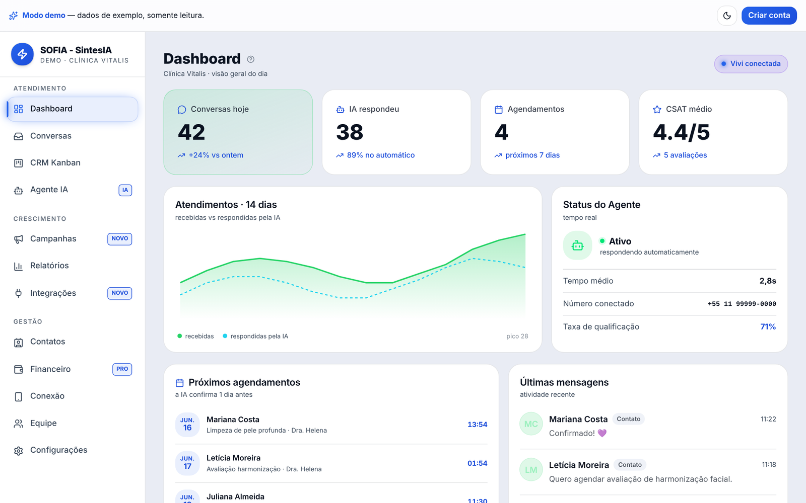
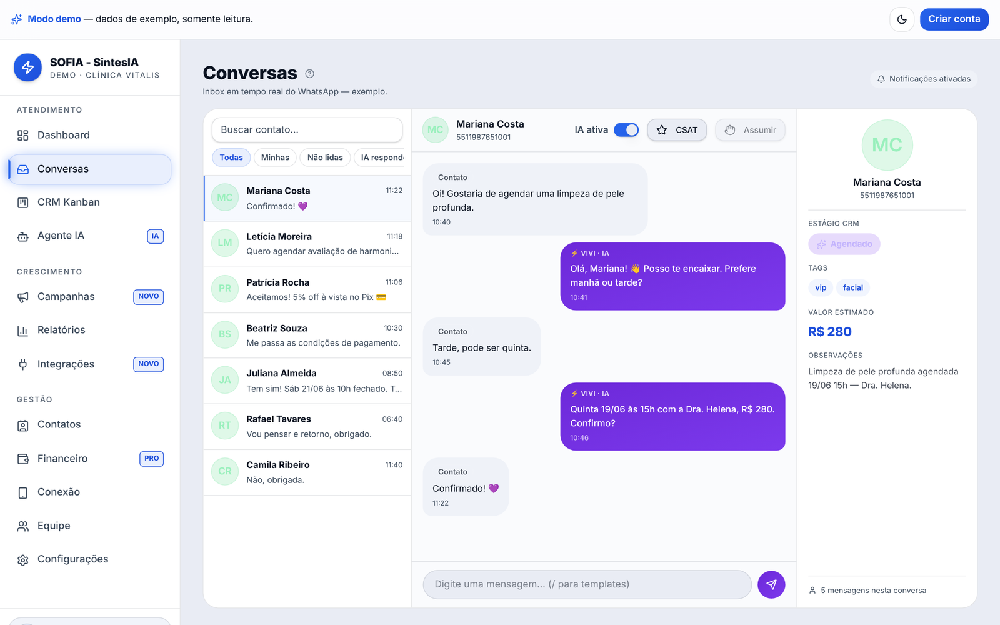
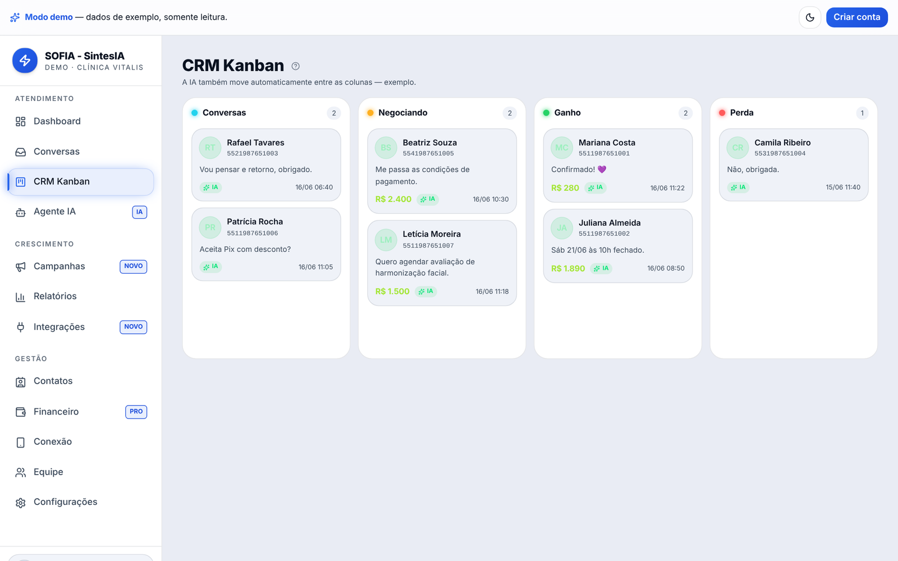
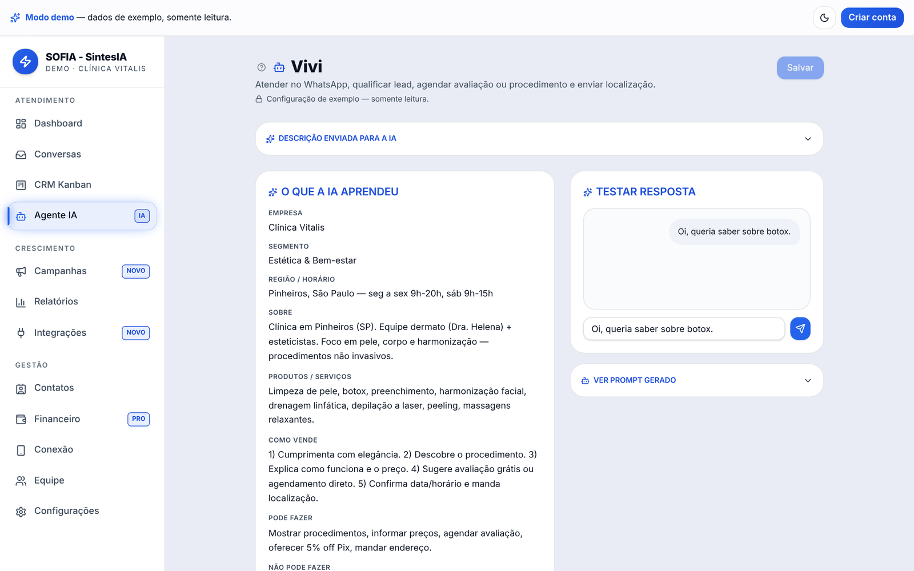
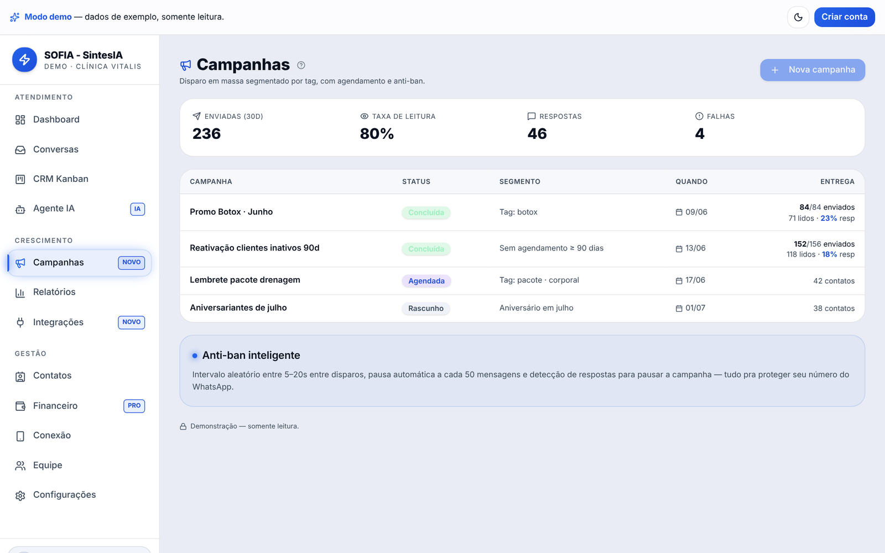
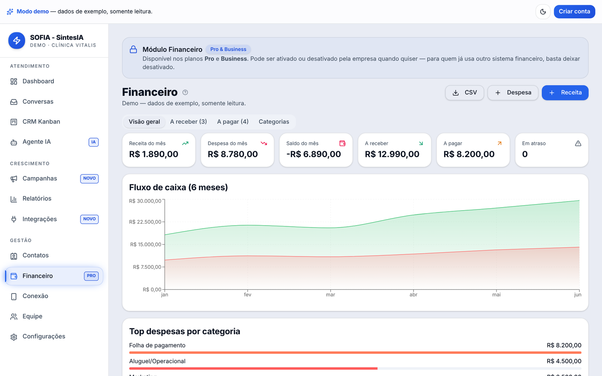
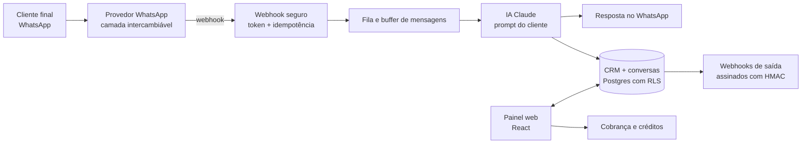

# Sofia — atendente de IA no WhatsApp com CRM

> Módulo de entrada do **SintesIA**: um agente de IA que atende clientes no WhatsApp, qualifica leads e organiza tudo em um CRM, pronto para pequenas e médias empresas.
>
> **Status:** em desenvolvimento ativo. Este repositório documenta a arquitetura e as decisões de produto. O código-fonte é privado.

## O que o produto faz

- **Atendimento no WhatsApp 24h** com IA treinada pelo próprio cliente (negócio, tom de voz, ofertas, FAQ, horários).
- **CRM kanban** que se atualiza sozinho: a IA move o lead entre estágios (Conversas, Negociando, Ganho, Perda).
- **Transferência para humano** a qualquer momento, com pausa e retomada por comando.
- **Campanhas** com envio espaçado e controle de ritmo.
- **Agenda** integrada ao Google Calendar.
- **Financeiro leve**: venda ganha no CRM gera receita automaticamente.
- **Multiempresa**: cada cliente tem sua equipe, papéis (dono, admin, atendente), plano e créditos de IA.
- **Painel master** para gestão de empresas, planos e assinaturas.
- **API pública e webhooks** assinados para integrar com outros sistemas.

## Telas

> Capturas do modo demonstração, com dados fictícios (clínica de exemplo).

| | |
|---|---|
|  **Dashboard** |  **Inbox de conversas com IA** |
|  **CRM kanban** |  **Treinamento do agente** |
|  **Campanhas** |  **Financeiro** |

## Arquitetura

## Stack

| Camada | Tecnologia |
|---|---|
| Front-end | React 19, TanStack Start, Tailwind CSS, shadcn/ui |
| Backend | Rotas de servidor (Nitro), Supabase (Postgres, Auth, RLS) |
| IA | Claude (Anthropic) |
| WhatsApp | Provedor intercambiável (WAHA / API oficial da Meta) |
| Hospedagem | Vercel + Supabase (região São Paulo) |
| Pagamentos | Provedores brasileiros (assinatura recorrente) |

## Decisões de engenharia

- **Segurança no banco, não só na tela.** Isolamento por empresa via Row Level Security, colunas de cobrança e créditos protegidas por gatilhos, funções sensíveis restritas ao sistema e acesso anônimo mínimo.
- **Créditos de IA com livro-razão.** Cada resposta consome crédito de forma atômica e fica registrada para auditoria.
- **Provedor de WhatsApp desacoplado.** A troca entre WAHA e a API oficial da Meta não exige mudar a regra de negócio.
- **LGPD desde o desenho.** Exportação de dados, log de auditoria e cuidado extra com dados de saúde para clínicas.
- **Infraestrutura própria.** Banco, hospedagem e IA sob contas do projeto, sem dependência de plataformas de geração de código em produção.

## Roadmap

- [x] Banco versionado em migrações, com camada de segurança
- [x] Projeto Supabase dedicado em São Paulo
- [ ] Migração do front-end para Vercel com domínio próprio
- [ ] IA direta via Claude, com transcrição de áudio
- [ ] Fila de mensagens e provedor oficial do WhatsApp
- [ ] Lançamento para pequenas empresas, depois clínicas

## Sobre

Criado por **Francklin**, fundador do SintesIA, em Brasília.
Contato: [linkedin.com/in/ffrancklin](https://www.linkedin.com/in/ffrancklin/)
